# 改訂履歴

| 版 | 日付 | 内容 | 作成 |
|---|---|---|---|
| 0.9 | 2026年10月16日 | ご確認用の初版。実際に動く試作版の画面を撮影して作成 | 有馬 順史 |
| 0.91 | 2026年10月16日 | 8.2 の K-01〜K-03 を修正した画面で撮り直し（報告一覧の全列表示、左メニューの表記、区分の日本語表示）。代理入力を要件定義書 1.1 の F-16・Q-07 に対応づけ | 有馬 順史 |
| 1.0 | 2026年11月10日 | 10月の業務ヒアリングのご要望とご回答（要件定義書 1.2）を反映。現場ホームの作業中の日報、作業日報 STEP2（品番・ロットの行）・STEP3（作業者ごとの従事行）・STEP4（行ごとの数量・不良、仕上げ・検査の数量）・STEP5、報告詳細の時間外を請求するかの指定と破棄、月次集計の作業者別・品番日別、マスタの項目、作業結果報告書の様式。在庫の画面（ご相談中）を追加 | 有馬 順史 |

# 1. はじめに

## 1.1 本書の目的

本書は、作業日報デジタル化システムの画面について、どの画面があり、どの順に進み、それぞれの画面で何を表示し、何を入力し、どう操作するかをまとめたものです。お客様に画面の見た目・項目・並び・操作の流れをご確認いただき、ご要望を開発に反映するために使います。

## 1.2 本書の画面画像について

| 項目 | 内容 |
|---|---|
| 画像の出どころ | 実際に動く試作版の画面を撮影したもの（絵で描いたものではありません）。**1.0 版で変わる画面（見出しに「1.0 で変更」）は、画面の配置を示す図（線画）を載せています。改修後の試作版で撮り直して差し替えます** |
| 表示しているデータ | 試験用のデータ（お客様「試験用 A工業株式会社」「試験用 B製作所」、作業者「試験 一郎」など）。実際のマスタは導入時に登録します |
| 画面の大きさ | 現場の画面: iPad 縦向き（幅 810）。事務所の画面: パソコン（幅 1366） |
| 機能の範囲 | 提案書（SK-2026-08-MINI）の範囲の機能だけを表示しています |
| 文字の書体 | 撮影環境の書体です。iPad では iPad の標準の書体（ヒラギノ）で表示されます |

画面は、ご要望に応じて項目名・並び・色・文言を変更できます。

## 1.3 関連する資料

| 資料 | 文書番号 | 本書との関係 |
|---|---|---|
| 提案書 | SK-2026-08-MINI | 機能の範囲と画面のイメージ（P.5〜P.10） |
| 要件定義書 | SK-2026-08-MINI-02 | 入力項目・計算・帳票の内容（4章） |
| 基本設計書 | SK-2026-08-MINI-03 | 画面一覧・画面の共通ルール（3章）、帳票の一覧（4章） |
| 操作マニュアル | SK-2026-08-MINI-06 | 利用者向けの操作手順 |

# 2. 画面の一覧と流れ

## 2.1 画面の一覧

| 画面番号 | 画面名 | 使う人 | 使う端末 | 本書 |
|---|---|---|---|---|
| SCR-01 | ログイン | 全員 | iPad・パソコン | 4.1 |
| SCR-02 | ホーム | 全員 | iPad・パソコン | 4.2・5.1 |
| SCR-03 | 現場ホーム | 現場・事務所 | iPad | 4.3 |
| SCR-04〜06 | 運搬実績の登録（STEP1〜3） | 現場・事務所 | iPad | 4.4 |
| SCR-07〜11 | 作業日報の登録（STEP1〜5） | 現場・事務所 | iPad | 4.5 |
| SCR-12 | 登録完了 | 現場・事務所 | iPad | 4.6 |
| SCR-13 | 報告一覧 | 事務所・管理者・監査 | パソコン | 5.2 |
| SCR-14 | 報告詳細（PDF・再出力・運搬費・修正） | 事務所・管理者・監査 | パソコン | 5.3〜5.5 |
| SCR-15 | 月次集計 | 事務所・管理者・監査 | パソコン | 5.7 |
| SCR-16 | マスタ一覧 | 事務所（参照のみ）・管理者 | パソコン | 5.8 |
| SCR-17 | マスタの追加・編集 | 管理者 | パソコン | 5.8 |
| SCR-18 | 利用者管理 | 管理者（事務所・監査は参照のみ） | パソコン | 5.9 |
| SCR-19 | 在庫（丸五ゴム様、ご相談中・範囲外） | 事務所（監査は参照のみ） | パソコン | 5.10 |

事務所の方は、パソコンからも iPad の入力画面（SCR-03〜12）を使えます。現場の方の代わりに作業日報を入力する「代理入力」もこの画面で行います（5.6）。

## 2.2 利用者の区分と使える画面

| 区分 | 使える画面 | できること |
|---|---|---|
| 現場 | SCR-01〜12 | 作業日報・運搬実績の入力と確定、自分が登録した報告と PDF の表示 |
| 事務所 | SCR-01〜16、SCR-18（参照） | すべての報告の確認・修正・PDF の再出力・運搬費の入力、月次集計と出力、マスタの参照、作業日報・運搬実績の入力（代理入力を含む） |
| 管理者 | SCR-01〜02、SCR-13〜18 | マスタの追加・修正・無効化、利用者の管理、報告の確認・PDF の再出力・運搬費の入力、月次集計と出力 |
| 監査 | SCR-01〜02、SCR-13〜16、SCR-18（参照） | 報告・月次集計の参照と出力（変更はできません） |

1人に複数の区分を設定できます（例: 事務所＋管理者）。区分にない画面を開くと「この画面を表示する権限がありません」と表示します。

## 2.3 画面の流れ

<figure>
<svg viewBox="0 0 860 400" xmlns="http://www.w3.org/2000/svg" font-family="Noto Sans CJK JP, Yu Gothic, sans-serif" font-size="12">
  <g fill="#ffffff" stroke="#16233F">
    <rect x="10" y="180" width="120" height="40" rx="5"/>
    <rect x="160" y="180" width="120" height="40" rx="5"/>
    <rect x="320" y="60" width="140" height="40" rx="5"/>
    <rect x="500" y="20" width="170" height="40" rx="5"/>
    <rect x="500" y="100" width="170" height="40" rx="5"/>
    <rect x="700" y="60" width="150" height="40" rx="5"/>
    <rect x="320" y="200" width="140" height="36" rx="5"/>
    <rect x="320" y="250" width="140" height="36" rx="5"/>
    <rect x="320" y="300" width="140" height="36" rx="5"/>
    <rect x="320" y="350" width="140" height="36" rx="5"/>
    <rect x="500" y="200" width="170" height="36" rx="5"/>
  </g>
  <g text-anchor="middle" fill="#16233F">
    <text x="70" y="205">SCR-01 ログイン</text>
    <text x="220" y="205">SCR-02 ホーム</text>
    <text x="390" y="85">SCR-03 現場ホーム</text>
    <text x="585" y="45">SCR-07〜11 作業日報</text>
    <text x="585" y="125">SCR-04〜06 運搬実績</text>
    <text x="775" y="85">SCR-12 登録完了</text>
    <text x="390" y="223">SCR-13 報告一覧</text>
    <text x="390" y="273">SCR-15 月次集計</text>
    <text x="390" y="323">SCR-16・17 マスタ</text>
    <text x="390" y="373">SCR-18 利用者管理</text>
    <text x="585" y="223">SCR-14 報告詳細</text>
  </g>
  <g stroke="#BD8226" stroke-width="1.5" fill="none">
    <line x1="130" y1="200" x2="160" y2="200"/>
    <polyline points="280,195 300,195 300,80 320,80"/>
    <polyline points="280,205 300,205 300,368 320,368"/>
    <line x1="300" y1="218" x2="320" y2="218"/>
    <line x1="300" y1="268" x2="320" y2="268"/>
    <line x1="300" y1="318" x2="320" y2="318"/>
    <polyline points="460,75 480,75 480,40 500,40"/>
    <polyline points="460,85 480,85 480,120 500,120"/>
    <polyline points="670,40 685,40 685,75 700,75"/>
    <polyline points="670,120 685,120 685,85 700,85"/>
    <line x1="460" y1="218" x2="500" y2="218"/>
    <line x1="585" y1="200" x2="585" y2="140" stroke-dasharray="4 3"/>
  </g>
  <text x="593" y="175" fill="#67707A">修正・代理入力（同じ入力画面）</text>
  <text x="475" y="300" fill="#67707A">事務所の画面は左のメニューから移動</text>
</svg>
<figcaption>図 2-1 画面の流れ</figcaption>
</figure>

# 3. 画面の共通ルール

## 3.1 画面の構成

| 端末 | 構成 |
|---|---|
| iPad（現場の画面） | 上部にシステム名・ログイン中の方の名前・ログアウト。その下に通信の状態（オンライン／オフライン）、下書きの保存状態。入力画面では、いまどの段階かを示す STEP の表示と「戻る」「次へ進む」ボタン |
| パソコン（事務所の画面） | 左にメニュー（報告一覧・月次集計・マスター管理・利用者管理・ホーム）、上部に画面名・ログイン中の方の名前と区分・ログアウト。画面の幅が 900 以下ではメニューを「一覧」「集計」「マスタ」「利用者」「ホーム」と短く表示 |

## 3.2 表示と入力のルール

| 項目 | ルール |
|---|---|
| 必須・任意 | 項目名の横に「必須」（赤）または「任意」を表示します |
| 入力の誤り | 「次へ進む」「確定」を押したときに確かめ、誤りのある項目を赤枠にして近くに理由を表示します。画面上部にも「入力内容を確認してください」として一覧を表示し、押すとその項目へ移動します |
| 選択肢 | マスタに登録した有効な項目だけを表示します。品番・作業内容・不良種別は、選んだお客様・品番に属するものだけを表示します |
| 日付・時刻 | 日付は 2026/10/16、時刻は 24 時間表示（5分刻み）。帳票では和暦（令和8年10月16日（金））で表示します |
| 数量・金額・時間 | 数量はけた区切り（1,600個）、金額は円（7,500円）、時間は小数2けたの時間（1.92H） |
| 確定 | 確認画面で「内容を確認しました」にチェックしてから「確定して登録」を押します。押した後は処理が終わるまで押せません（二重登録を防ぎます） |
| 下書き | 入力途中の内容は iPad に自動で保存されます（入力から約1秒後）。画面を閉じても、現場ホームの「下書きを再開」から続けられます。最後の保存から24時間、またはログアウトで消えます |
| 通信切れ | 画面上部に「オフラインです」と表示し、確定ボタンを押せなくします。入力は続けられ、通信が戻れば確定できます |
| 同時更新 | 他の方が先に同じ報告を更新していた場合は保存せず、最新の内容の読み込みを促します |
| 自動ログアウト | 30分操作がないか、ログインから12時間たつとログイン画面に戻ります |
| 操作のしやすさ | iPad の指で押しやすい大きさのボタン、文字と背景のはっきりした色の差、キーボードだけでも操作できること（見やすさ・使いやすさの国際的な基準 WCAG 2.1 AA に合わせています） |

# 4. 現場の画面（iPad）

## 4.1 ログイン（SCR-01）

<figure class="ipad">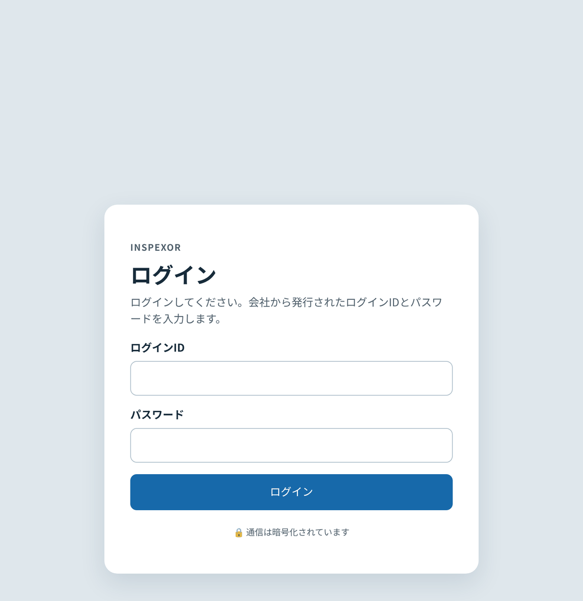<figcaption>図 4-1 ログイン（iPad）</figcaption></figure>

| 項目 | 種類 | 必須 | 内容・規則 |
|---|---|---|---|
| ログインID | 文字入力 | 必須 | 会社から発行したログインID |
| パスワード | 文字入力（伏せ字） | 必須 | |
| ログイン | ボタン | | 正しければホーム（SCR-02）へ進みます |

- ログインID かパスワードが違う場合は「ログインIDまたはパスワードが正しくありません。」と表示します（どちらが違うかは表示しません）。
- 5回続けて間違えると15分間ログインできなくなります。短い時間に何度も試した場合も、しばらく待ってからの再試行をお願いする表示になります。

## 4.2 ホーム（SCR-02、現場の方）

<figure class="ipad">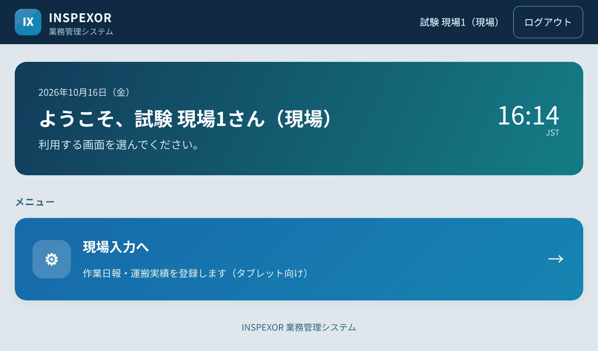<figcaption>図 4-2 ホーム（現場の方）</figcaption></figure>

ログイン直後の画面です。日付・時刻と、区分に応じた入口を表示します。現場の方は「現場入力へ」だけが表示されます。事務所・管理者の画面は 5.1 を参照してください。

## 4.3 現場ホーム（SCR-03）（1.0 で変更）

<figure class="ipad">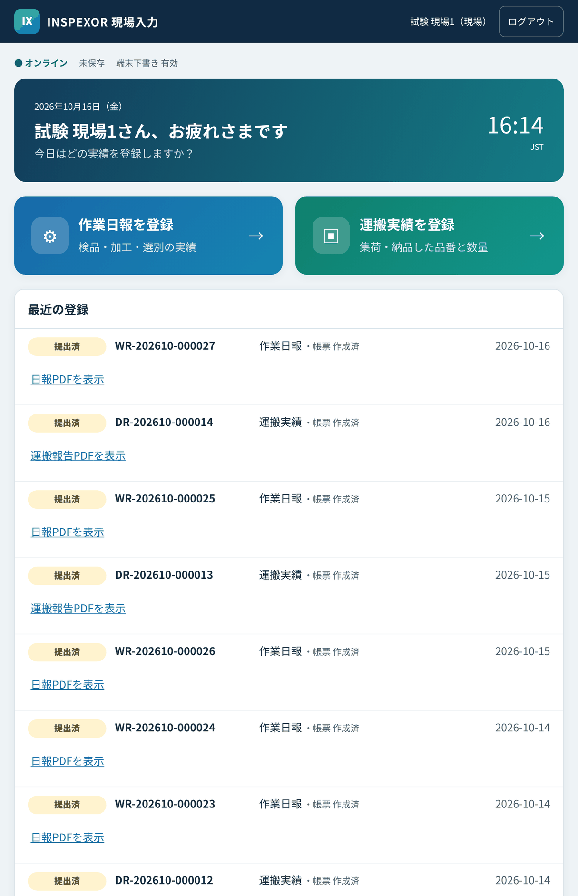<figcaption>図 4-3 現場ホーム（0.91 版の画面。「作業中の日報」の欄を追加します）</figcaption></figure>

| 表示・操作 | 内容 |
|---|---|
| あいさつ・日付・時刻 | ログイン中の方の名前、今日の日付（曜日）、現在時刻 |
| 作業日報を登録 | 作業日報の入力（SCR-07）へ進みます |
| 運搬実績を登録 | 運搬実績の入力（SCR-04）へ進みます |
| 作業中の日報（追加） | 作業を開始して、まだ終わっていない作業者がいる作業日報（**どなたが開始したものも表示**）。作業日・お客様・品番・作業中の人数・最初の開始時刻・報告者。「続きを入力」で STEP3 を開き、作業者の追加・終了ができます |
| この端末の下書き | 入力途中の下書きがあれば「下書きを再開（StepN）」を表示します。押すと続きから入力できます |
| 最近の登録 | 自分が登録した報告を新しい順に10件。状態、報告番号、種別、帳票の状態、日付と、PDF を表示するリンク |

## 4.4 運搬実績の登録（SCR-04〜06）

3つの段階（基本情報 → 品番・数量 → 確認）で入力します。

### STEP1 基本情報（SCR-04）

<figure>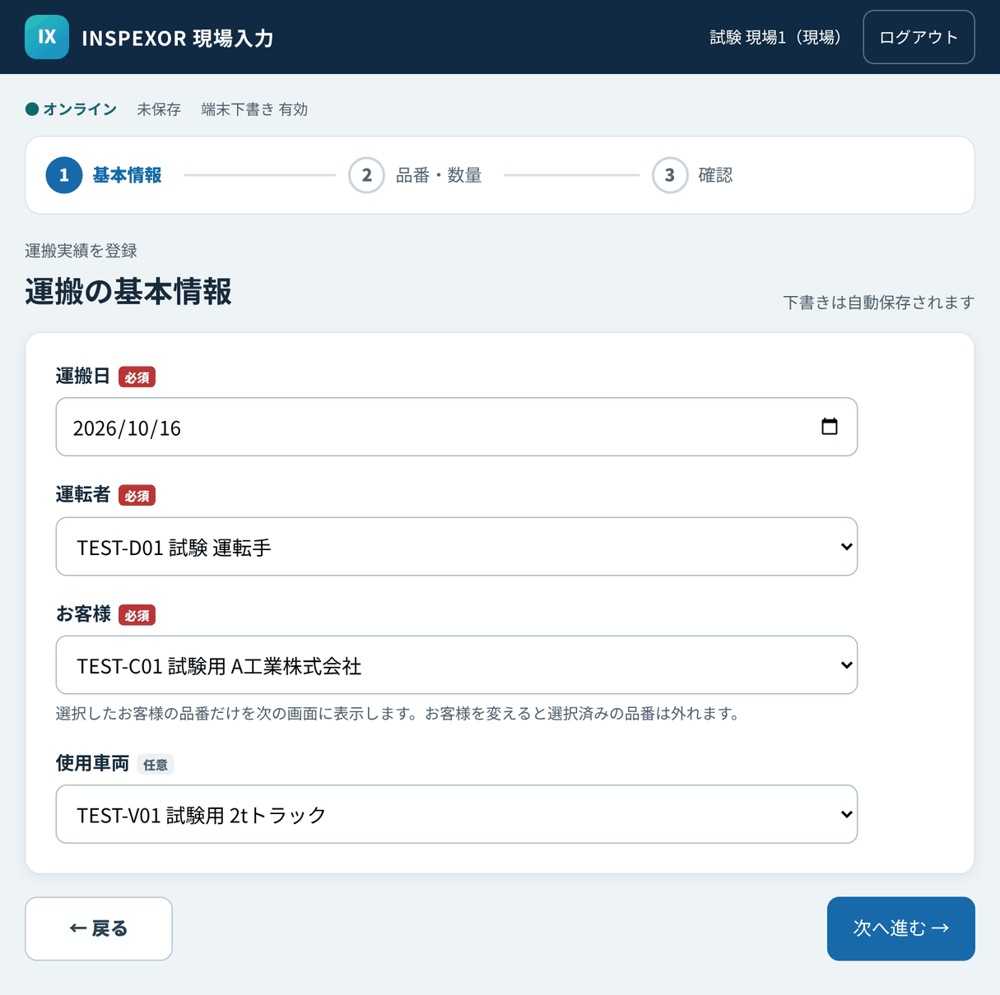<figcaption>図 4-4 運搬 STEP1</figcaption></figure>
<figure>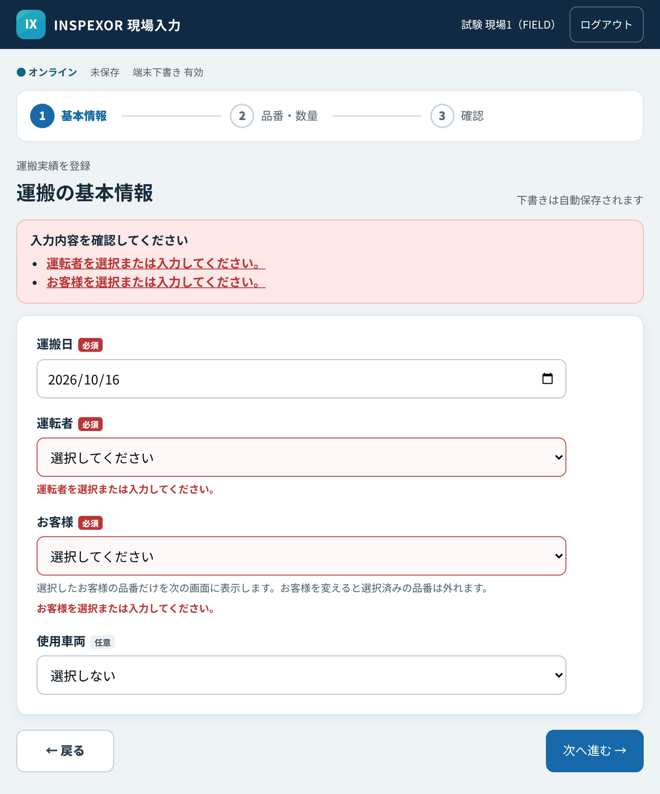<figcaption>図 4-5 必須項目が未入力のとき</figcaption></figure>

| 項目 | 種類 | 必須 | 内容・規則 |
|---|---|---|---|
| 運搬日 | 日付 | 必須 | 初期値は今日 |
| 運転者 | 選択 | 必須 | 作業者マスタから選択 |
| お客様 | 選択 | 必須 | お客様マスタから選択。お客様を変えると、次の段階で選んだ品番は解除されます |
| 使用車両 | 選択 | 任意 | 車両マスタから選択 |

### STEP2 品番・数量（SCR-05）

<figure class="ipad">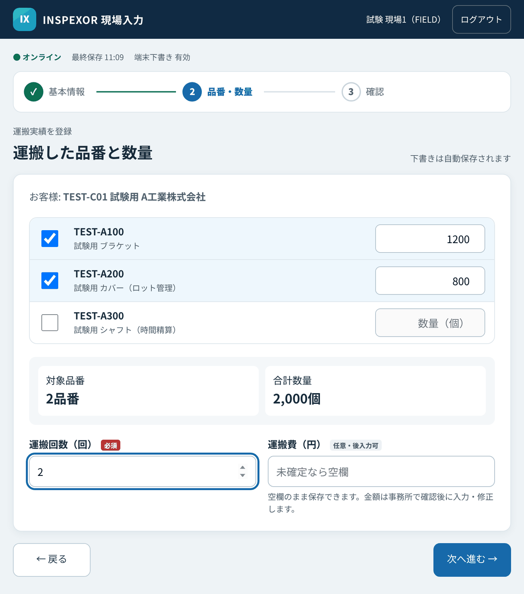<figcaption>図 4-6 運搬 STEP2</figcaption></figure>

| 項目 | 種類 | 必須 | 内容・規則 |
|---|---|---|---|
| 品番と数量 | チェック＋数値 | 必須 | 選んだお客様の品番を一覧表示。運んだ品番にチェックを入れ、数量（1〜999,999個）を入力。1品番以上 |
| 対象品番・合計数量 | 表示 | | チェックした品番の数と数量の合計を自動で表示 |
| 運搬回数 | 数値 | 必須 | 1〜99回（初期値 1） |
| 運搬費（円） | 数値 | 任意 | 0〜9,999,999円。空欄のまま保存でき「未確定（事務所で入力）」になります。自動計算はしません |

### STEP3 確認（SCR-06）

<figure class="ipad">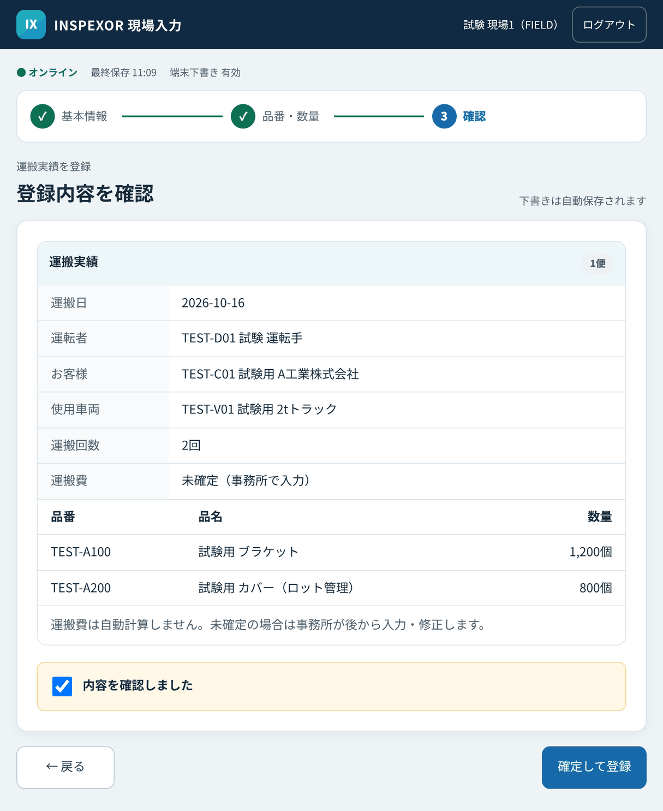<figcaption>図 4-7 運搬 STEP3（確認）</figcaption></figure>

入力内容を一覧で表示します。「内容を確認しました」にチェックして「確定して登録」を押すと、報告番号（DR-年月-連番）を付けて登録します。登録後は登録完了（SCR-12）を表示します。

## 4.5 作業日報の登録（SCR-07〜11）

5つの段階（基本情報 → 品番・作業内容 → 作業者・時間 → 数量・不良 → 確認）で入力します。

### STEP1 日付・報告者・お客様（SCR-07）

<figure class="ipad">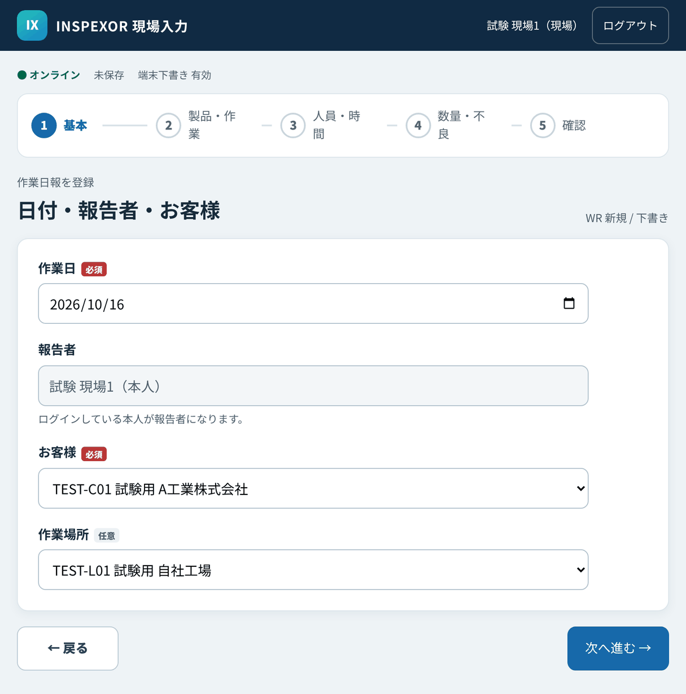<figcaption>図 4-8 作業 STEP1</figcaption></figure>

| 項目 | 種類 | 必須 | 内容・規則 |
|---|---|---|---|
| 作業日 | 日付 | 必須 | 初期値は今日 |
| 報告者 | 表示 | | ログイン中の本人。事務所の方は、現場の方を選んで代理で入力できます（5.6） |
| お客様 | 選択 | 必須 | お客様マスタから選択 |
| 作業場所 | 選択 | 任意 | 作業場所マスタから選択 |

### STEP2 品番・作業内容（SCR-08）（1.0 で変更）

<figure class="ipad">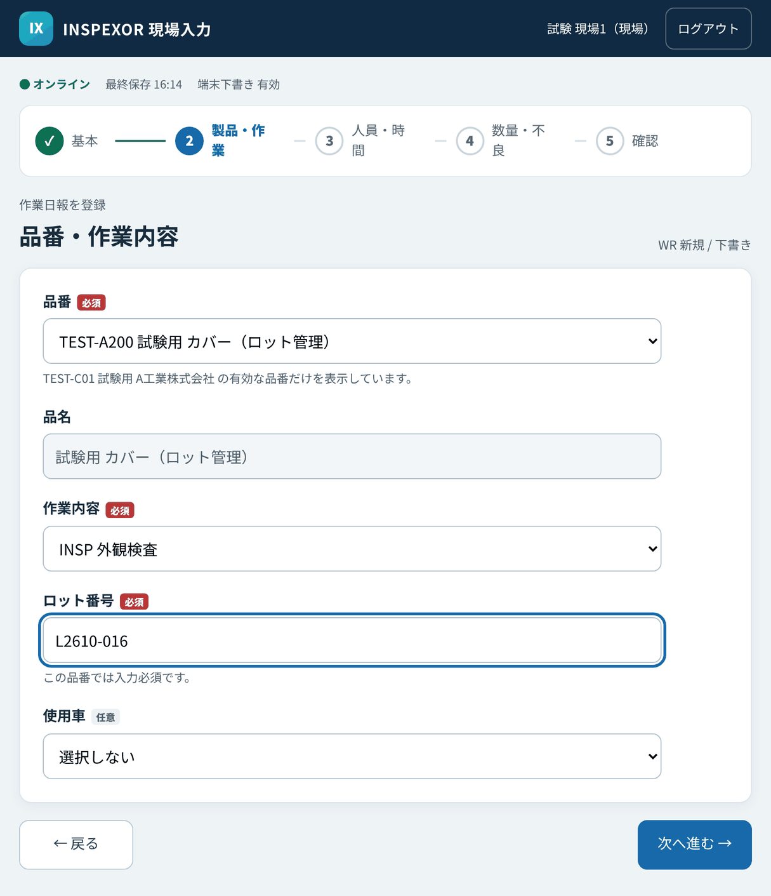<figcaption>図 4-9 作業 STEP2（0.91 版の画面。品番・ロットの行を追加できるようにします）</figcaption></figure>

| 項目 | 種類 | 必須 | 内容・規則 |
|---|---|---|---|
| 品番の明細 | 行の一覧 | 必須 | 1行に品番・作業内容・ロット番号。「＋ 品番・ロットを追加」で行を増やせます（20行まで）。1行だけのときは 0.91 版と同じ見た目です |
| 　品番 | 選択 | 必須 | 選んだお客様の品番から選択。品名を自動で表示 |
| 　作業内容 | 選択 | 必須 | 選んだ品番の作業内容から選択 |
| 　ロット番号 | 文字入力 | 品番による | 100文字まで。品番マスタで「ロット必須」の品番は必須。ロットごとに数量を分けるときは、同じ品番で行を分けます（例: MR529673 旧ロット／新ロット） |
| 作業場所 | 表示・変更 | 任意 | 作業内容に既定の作業場所があれば自動で入ります（例: MK412546 レーザー測定作業 → 丸五ゴム工業 本社） |
| 移動回数 | 数値 | 任意 | 作業場所が「お客様の工場」のときだけ表示。0〜99回 |
| 使用車 | 選択 | 任意 | 車両マスタから選択 |

1件にまとめられる品番は、同じ精算区分（個数／時間）・同じ工程の設定の品番です。時間で精算する品番は1件に1品番です（作業者の時間を品番ごとに分けられないため）。違う品番を選ぶと「この品番は同じ報告にまとめられません」と表示します。

### STEP3 作業者・作業時間（SCR-09）（1.0 で変更）

<figure>
<svg viewBox="0 0 760 430" xmlns="http://www.w3.org/2000/svg" font-family="Noto Sans CJK JP, Yu Gothic, sans-serif" font-size="12">
  <rect x="5" y="5" width="750" height="420" rx="8" fill="#ffffff" stroke="#16233F"/>
  <text x="20" y="30" font-weight="bold" fill="#16233F">STEP 3/5 作業者・作業時間　　2026/09/08（火）　丸五ゴム工業　MN139931</text>
  <rect x="20" y="42" width="720" height="26" fill="#16233F"/>
  <g fill="#ffffff"><text x="28" y="60">作業者</text><text x="140" y="60">区分</text><text x="230" y="60">開始</text><text x="320" y="60">終了</text><text x="420" y="60">休憩（分）</text><text x="510" y="60">うち時間外（分）</text><text x="640" y="60">実作業時間</text></g>
  <g fill="#16233F">
    <text x="28" y="92">試験 一郎</text><text x="140" y="92">検査 ▾</text><text x="230" y="92">08:30</text><text x="320" y="92">17:00</text><text x="440" y="92">60</text><text x="540" y="92">0</text><text x="650" y="92">7.50H</text>
    <text x="28" y="124">試験 二郎</text><text x="140" y="124">検査 ▾</text><text x="230" y="124">13:00</text><text x="320" y="124">17:00</text><text x="440" y="124">0</text><text x="540" y="124">0</text><text x="650" y="124">4.00H</text>
    <text x="28" y="156">試験 三子</text><text x="140" y="156">検査外 ▾</text><text x="230" y="156">08:30</text>
  </g>
  <rect x="312" y="140" width="70" height="24" rx="4" fill="#BD8226"/><text x="347" y="157" text-anchor="middle" fill="#ffffff">終了</text>
  <text x="420" y="156" fill="#67707A">作業中</text>
  <line x1="20" y1="104" x2="740" y2="104" stroke="#D8DCE3"/><line x1="20" y1="136" x2="740" y2="136" stroke="#D8DCE3"/><line x1="20" y1="168" x2="740" y2="168" stroke="#D8DCE3"/>
  <rect x="20" y="180" width="460" height="30" rx="4" fill="#FFF7E6" stroke="#BD8226"/>
  <text x="30" y="200" fill="#16233F">試験 一郎: 時間外の目安 0.00H　／ 昼の休憩が0分の行はありません</text>
  <rect x="20" y="222" width="150" height="34" rx="5" fill="#ffffff" stroke="#16233F"/><text x="95" y="244" text-anchor="middle" fill="#16233F">＋ 作業者を追加</text>
  <rect x="180" y="222" width="150" height="34" rx="5" fill="#ffffff" stroke="#16233F"/><text x="255" y="244" text-anchor="middle" fill="#16233F">行を取り消す</text>
  <rect x="20" y="272" width="720" height="62" rx="5" fill="#F4F5F1" stroke="#D8DCE3"/>
  <text x="32" y="294" fill="#16233F" font-weight="bold">合計</text>
  <text x="32" y="320" fill="#16233F">総作業時間 11.50H（作業中の行を除く）　検査 11.50H　検査外 0.00H　時間外 0.00H　作業時間帯 8:30〜17:00</text>
  <rect x="20" y="350" width="140" height="40" rx="5" fill="#ffffff" stroke="#16233F"/><text x="90" y="375" text-anchor="middle" fill="#16233F">← 戻る</text>
  <rect x="600" y="350" width="140" height="40" rx="5" fill="#8C96A6"/><text x="670" y="375" text-anchor="middle" fill="#ffffff">次へ進む</text>
  <text x="380" y="408" text-anchor="middle" fill="#67707A">終わっていない作業者がいる間は「次へ進む」を押せません（作業中の日報として保存されています）</text>
</svg>
<figcaption>図 4-10 作業 STEP3（1.0 で変更。配置を示す図）。8:30 から2名で開始し、13:00 に1名が途中参加、1名はまだ作業中</figcaption>
</figure>

| 項目 | 種類 | 必須 | 内容・規則 |
|---|---|---|---|
| 従事行 | 行の一覧 | 必須 | 作業者ごとの行（紙の報告書の「現地作業時間及び作業者名」の1行）。同じ方の中抜け・区分の切替えは行を分けます |
| 　作業者 | 選択 | 必須 | 作業者マスタから選択 |
| 　区分 | 選択 | 必須 | 検査／検査外。初期値は作業内容の既定の区分。仕上げ・検査の工程がある品番（ビナン様の一部）は「仕上げ」「検査」 |
| 　開始 | 時刻・ボタン | 必須 | 「開始」で現在時刻（近い方の5分）。手で直せます |
| 　終了 | 時刻・ボタン | 確定時必須 | 「終了」で現在時刻（近い方の5分）。作業中は空欄のままにできます |
| 　休憩（分） | 数値 | 必須 | 初期値0。昼休憩以外の休憩も合計して入れます |
| 　うち時間外（分） | 数値 | 必須 | 初期値0 |
| 　実作業時間 | 表示 | | 終了 − 開始 − 休憩 |
| 作業者を追加 | ボタン | | 行を追加します（途中参加） |
| 行を取り消す | ボタン | | 間違えて追加した行を取り消します（確定前だけ） |
| 目安 | 表示・ボタン | | 昼（12:00〜13:00）にかかる行で休憩が0分のとき「昼の休憩が0分です」、平日17時以降・土日・休日の行は「時間外の目安」を表示します。「目安を入れる」を押すと入ります。自動では入りません |
| 合計 | 表示 | | 総作業時間（全行の合計）・検査・検査外・時間外・作業時間帯。作業日が休日なら「休日」と表示 |

- 作業を開始すると、作業日報がクラウドに保存されます（作業中の日報）。他の方の iPad からも、現場ホームの「作業中の日報」から作業者を追加・終了できます。
- 作業が終わってから、全員の開始・終了を手で入れることもできます。
- 終わっていない作業者がいる間は STEP4 へ進めません。
- 例: 2名がともに 9:30〜11:25（休憩0分）→ 各 1.92H、総作業時間 3.83H（提案書 P.9 と同じ値）。

### STEP4 数量・不良（SCR-10）（1.0 で変更）

<figure>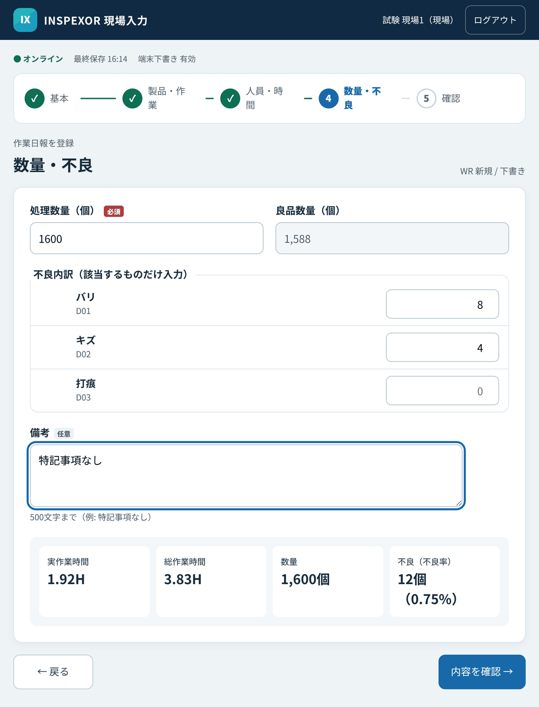<figcaption>図 4-12 作業 STEP4（0.91 版の画面。品番の行ごとに入力します）</figcaption></figure>
<figure>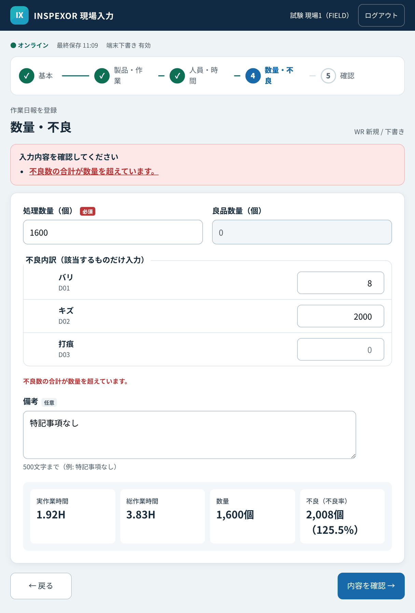<figcaption>図 4-13 不良の合計が数量を超えたとき</figcaption></figure>

| 項目 | 種類 | 必須 | 内容・規則 |
|---|---|---|---|
| 処理数量（個） | 数値 | 必須 | 品番の行ごと。0〜999,999個 |
| 仕上げ数量・検査数量（個） | 数値 | 必須 | 工程ごとに数量を入れる品番（例: A8202415600）だけ、処理数量の代わりに表示。その日に行った分だけ入れます（片方は0でかまいません） |
| 良品数量（個） | 表示 | | 処理数量 − 不良の合計（参考表示） |
| 不良内訳 | 数値 | 任意 | 品番ごとに登録した不良種別（品番一覧の NG の項目）ごとに個数を入力 |
| その他の内容 | 文字入力 | 任意 | 「その他」の個数を入れたとき、内容（20文字まで。例: 色ハゲ、サンプル） |
| 備考 | 文字入力 | 任意 | 500文字まで |
| 集計の表示 | 表示 | | 総作業時間・数量・不良（不良率） |

### STEP5 確認（SCR-11）

<figure class="ipad">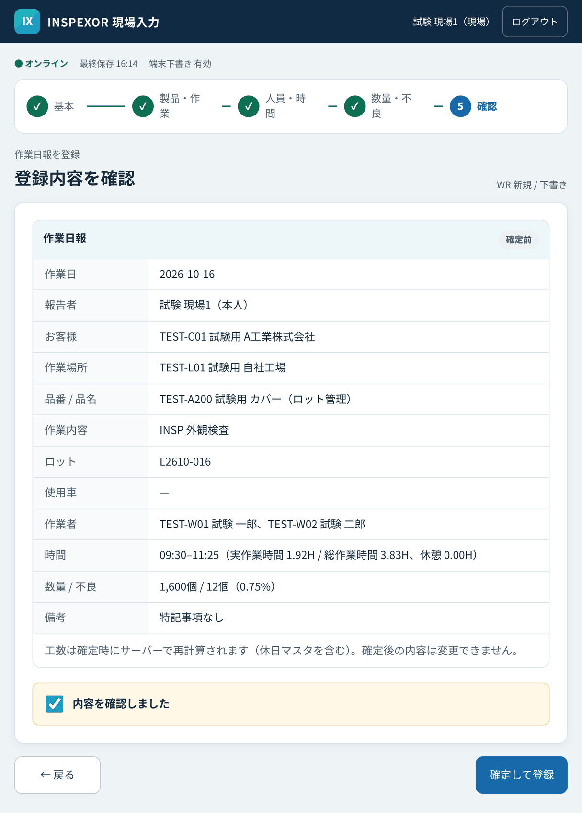<figcaption>図 4-14 作業 STEP5（確認）</figcaption></figure>

入力した全項目（従事行の一覧と合計、品番の行ごとの数量・不良）と、計算した時間・不良率を表示します。「内容を確認しました」にチェックして「確定して登録」を押すと登録します（報告番号は作業を開始したときに付いています）。時間は登録時にもう一度計算して保存します。（1.0 で変更）

## 4.6 登録完了（SCR-12）

<figure>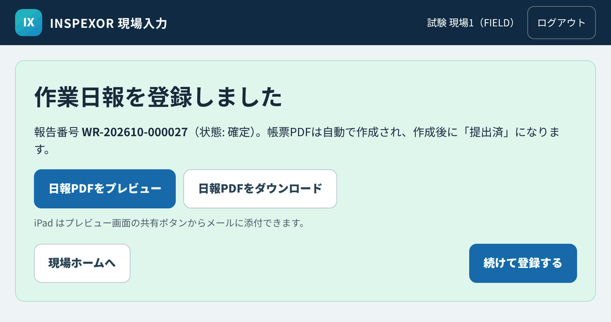<figcaption>図 4-15 作業日報の登録完了</figcaption></figure>
<figure>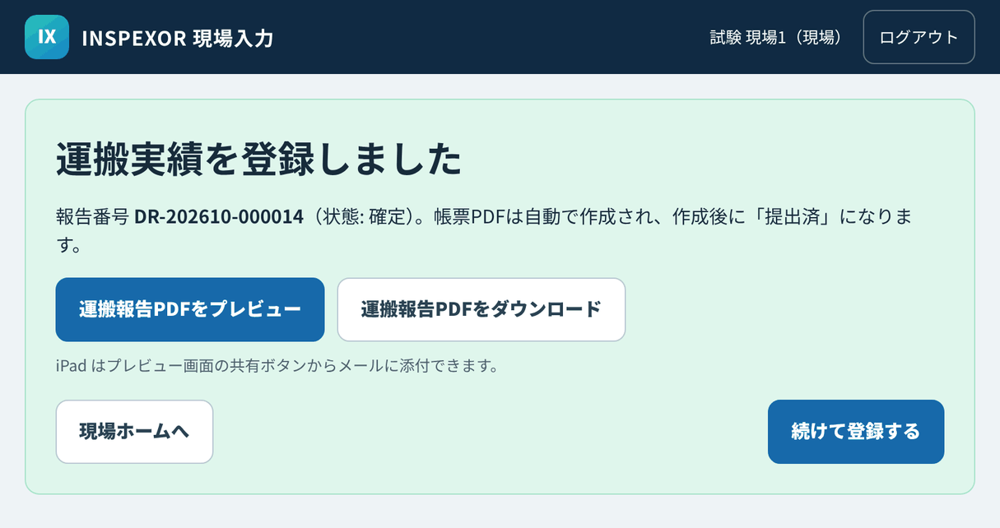<figcaption>図 4-16 運搬実績の登録完了</figcaption></figure>

| 表示・操作 | 内容 |
|---|---|
| 報告番号・状態 | 付いた報告番号と状態。PDF ができると「提出済」になります |
| PDFをプレビュー | PDF を新しい画面で表示します。PDF は登録から数秒で作成され、作成されるとボタンが表示されます |
| PDFをダウンロード | PDF を iPad に保存します |
| メールへの添付 | プレビュー画面の共有ボタンから、iPad のメールに添付して送れます（システムからの自動送信はしません） |
| 現場ホームへ／続けて登録する | 現場ホーム、または同じ種類の新しい入力へ進みます |

## 4.7 通信が切れたとき

<figure class="ipad">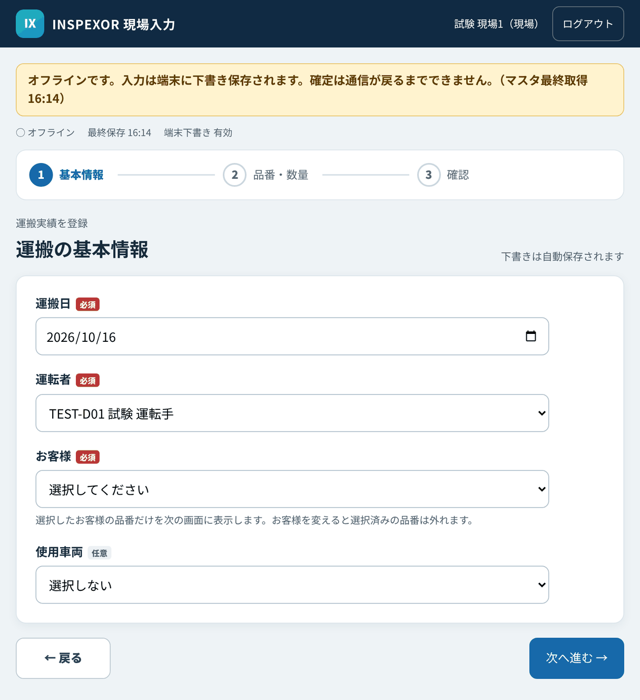<figcaption>図 4-17 通信が切れたときの表示</figcaption></figure>

画面上部に「オフラインです。入力は端末に下書き保存されます。確定は通信が戻るまでできません。」と表示します。入力はそのまま続けられ、通信が戻ると表示が消えて確定できるようになります。

# 5. 事務所の画面（パソコン）

## 5.1 ログイン・ホーム（SCR-01・02）

<figure>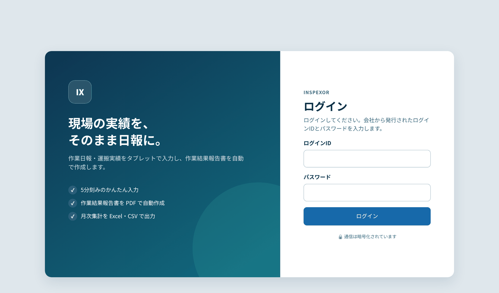<figcaption>図 5-1 ログイン（パソコン）</figcaption></figure>
<figure>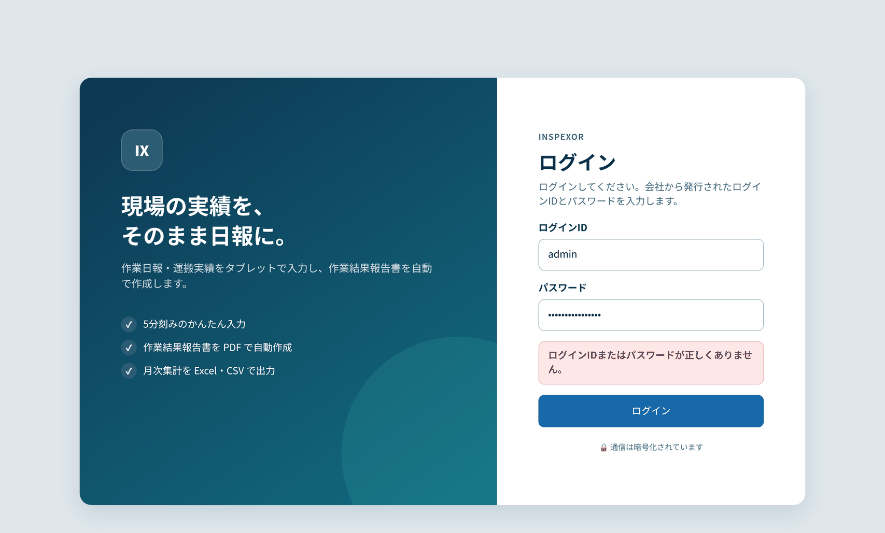<figcaption>図 5-2 ログインID・パスワードが違うとき</figcaption></figure>

<figure>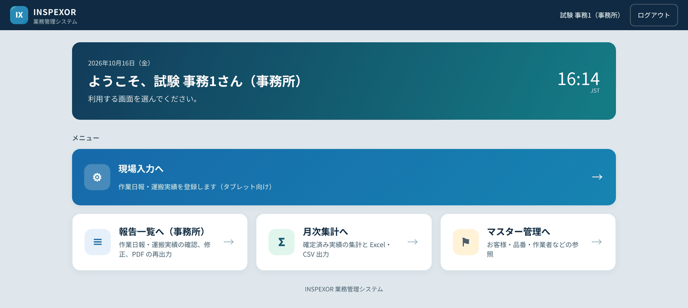<figcaption>図 5-3 ホーム（事務所の方）</figcaption></figure>
<figure>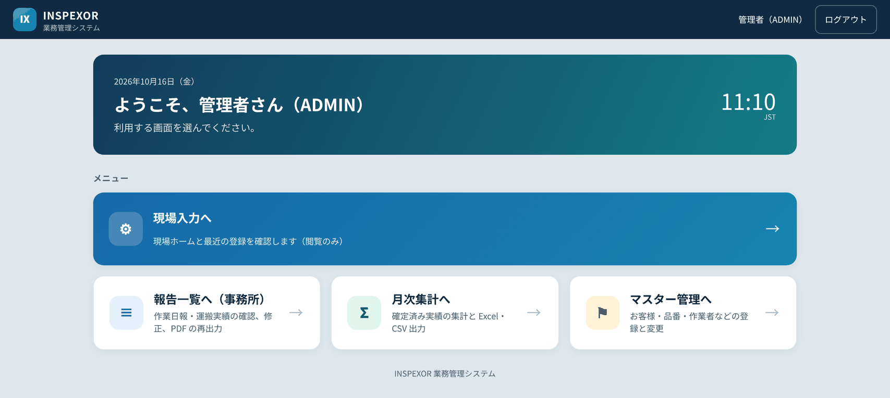<figcaption>図 5-4 ホーム（管理者）</figcaption></figure>

ホームには区分に応じた入口（現場入力へ、報告一覧へ、月次集計へ、マスター管理へ）を表示します。

## 5.2 報告一覧（SCR-13）

<figure>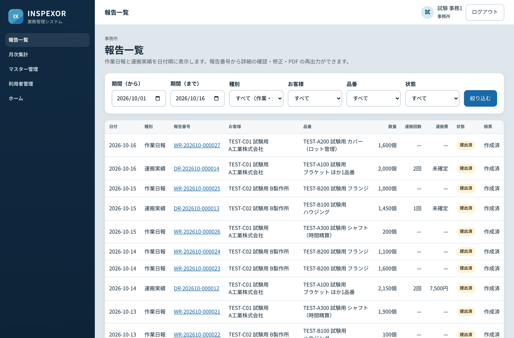<figcaption>図 5-5 報告一覧</figcaption></figure>

| 項目 | 種類 | 内容・規則 |
|---|---|---|
| 期間（から・まで） | 日付 | 初期値は今月の1日から今日 |
| 種別 | 選択 | すべて／作業日報／運搬実績 |
| お客様・品番 | 選択 | すべて、または1つ |
| 状態 | 選択 | すべて／下書き／確定／提出済 |
| 絞り込む | ボタン | 条件で一覧を表示し直します |
| 一覧 | 表 | 日付・種別・報告番号・お客様・品番（複数は「ほか N品番」）・数量・運搬回数・運搬費（未入力は「未確定」）・状態・帳票の状態。日付の新しい順、同じ日は登録の新しい順。お客様・品番の長い名称は折り返して、幅 1280 以上の画面で全列を表示 |
| 報告番号 | リンク | 報告詳細（SCR-14）を開きます |

<figure>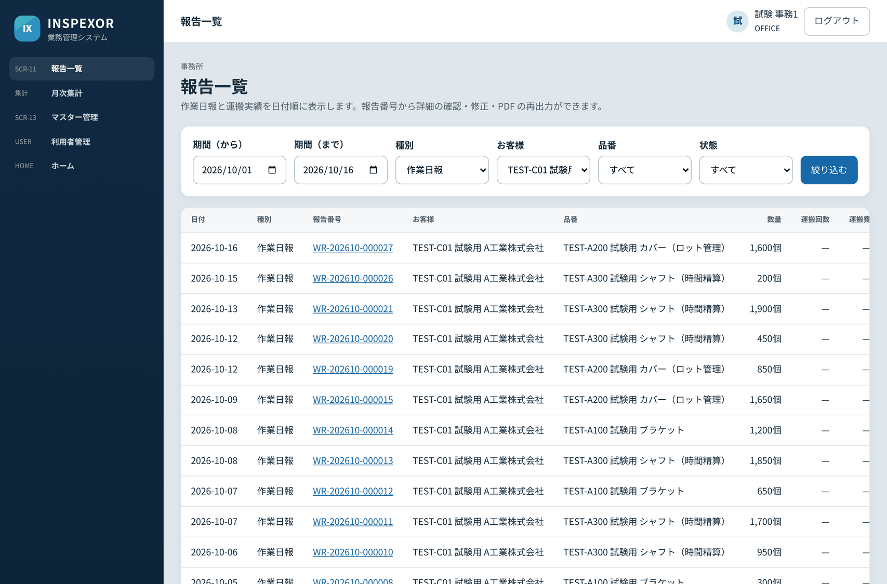<figcaption>図 5-6 種別・お客様で絞り込んだ一覧</figcaption></figure>

## 5.3 報告詳細（SCR-14）（1.0 で変更）

<figure>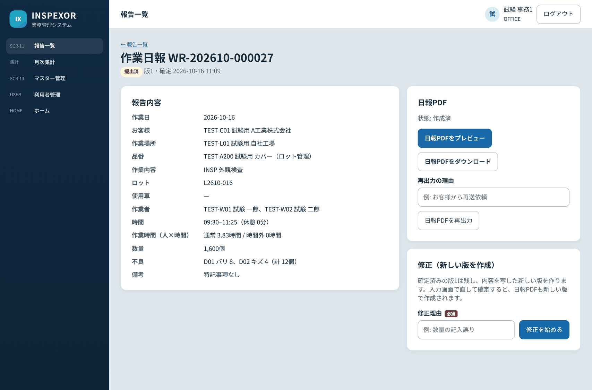<figcaption>図 5-7 作業日報の詳細（0.91 版の画面。従事行・品番の行と「時間外を請求する」を追加します）</figcaption></figure>

| 表示・操作 | 内容 |
|---|---|
| 見出し | 種別と報告番号、状態（作業中・破棄を含む）、版の番号、確定日時 |
| 報告内容 | 入力したすべての項目。従事行の一覧（作業者・区分・開始・終了・休憩・時間外・実作業時間）と合計（総作業時間・検査・検査外・時間外）、品番の行ごとの数量・不良 |
| 時間外を請求する（追加） | 確定した作業日報で「する／しない」を選び、理由（任意）を入れて保存します。初期値は「しない」。新しい版は作らず、変更の記録を残します。時間外の時間が0の報告では表示しません |
| 日報PDF | PDF の状態（作成中・作成済）、プレビュー・ダウンロード |
| 日報PDFを再出力 | 再出力の理由（必須）を入力して PDF を作り直します（5.5） |
| 修正 | 修正理由（必須）を入力して「修正を始める」を押します（5.4） |
| 下書きを破棄（追加） | 確定したことのない作業日報だけ。理由（必須）を入れて破棄します。一覧の初期の条件と集計から外れ、記録は残ります |
| 代理入力 | 代理入力で登録した報告には、入力した方・日時・理由を表示します |

## 5.4 運搬費の入力と報告の修正

<figure>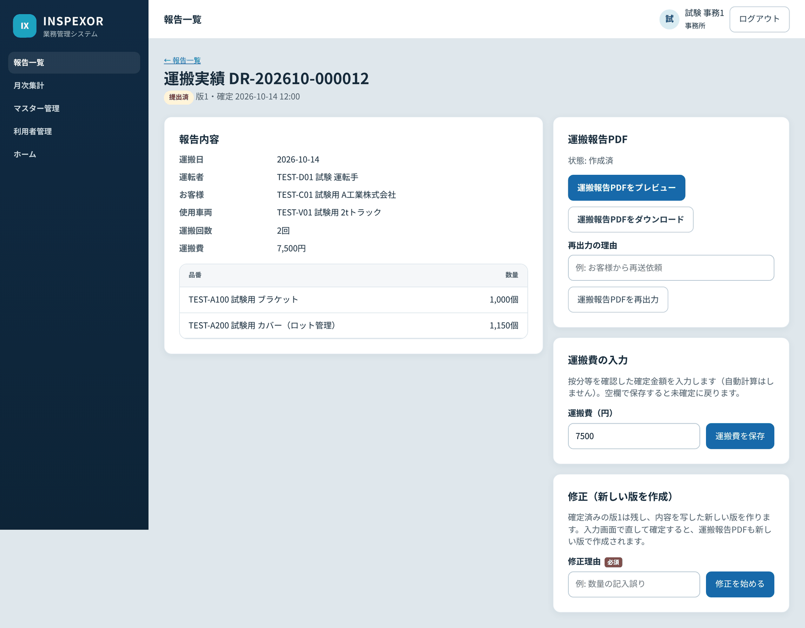<figcaption>図 5-8 運搬実績の詳細</figcaption></figure>
<figure><figcaption>図 5-9 運搬費を入力した後</figcaption></figure>

| 操作 | 内容・規則 |
|---|---|
| 運搬費の入力 | 運搬実績の詳細の「運搬費の入力」で、確定した金額（0〜9,999,999円）を入力して「運搬費を保存」。空欄で保存すると「未確定」に戻ります。運搬費の変更では新しい版は作らず、変更の記録を残します |
| 報告の修正 | 「修正理由」を入力して「修正を始める」を押すと、新しい版の下書きができ、現場と同じ入力画面（図 5-10）が開きます。入力し直して確定すると、新しい版の PDF を作ります。前の版とその PDF は残ります |

<figure>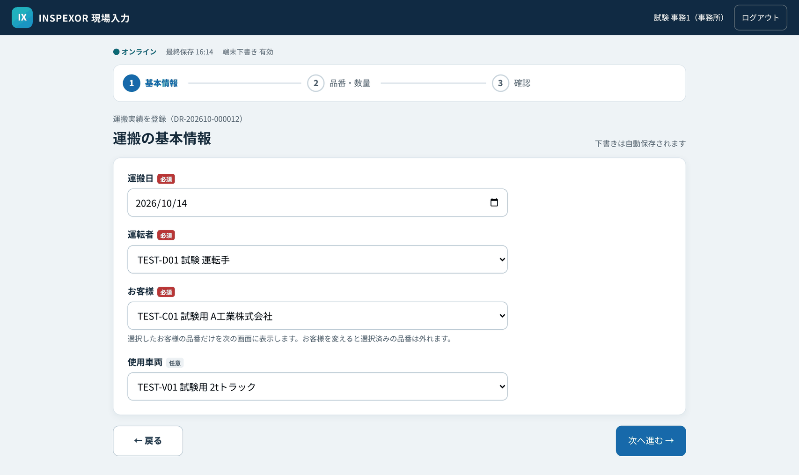<figcaption>図 5-10 修正の入力画面（現場と同じ画面。見出しに報告番号を表示）</figcaption></figure>

修正中も、月次集計では前の確定版の値で数えます。

## 5.5 PDF の再出力

<figure>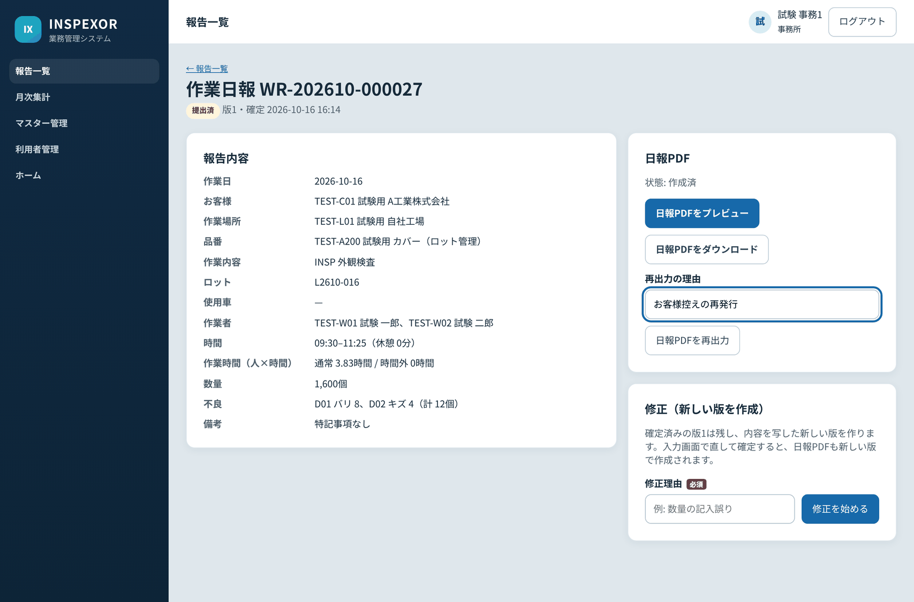<figcaption>図 5-11 再出力の理由を入力したところ</figcaption></figure>

「再出力の理由」（必須、例: お客様から再送依頼）を入力して「日報PDFを再出力」を押すと、PDF を作り直します。PDF は、最初に作ったときの様式で作り直します。

## 5.6 代理入力（事務所の方が作業日報を入力）

<figure>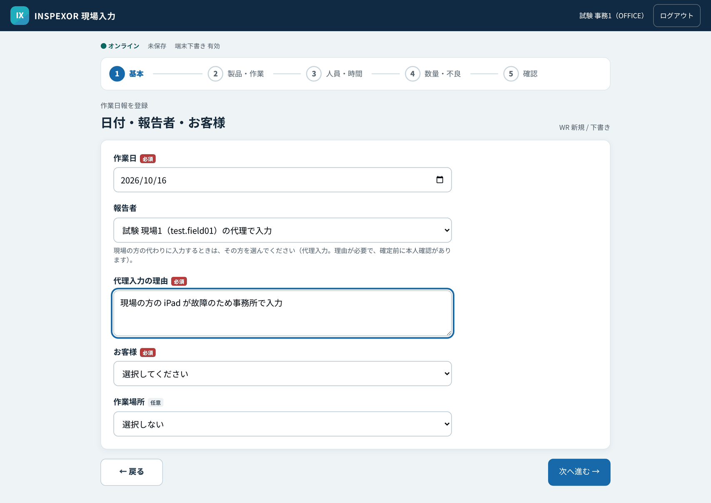<figcaption>図 5-12 報告者に現場の方を選んだところ</figcaption></figure>

| 項目 | 種類 | 必須 | 内容・規則 |
|---|---|---|---|
| 報告者 | 選択 | 必須 | 初期値は本人。有効な現場の方を選ぶと「○○（ログインID）の代理で入力」になります |
| 代理入力の理由 | 文字入力 | 代理のとき必須 | 500文字まで（例: 現場の方の iPad が故障のため事務所で入力） |

代理で登録した作業日報は、選んだ現場の方の報告として、その方の現場ホームにも表示されます。報告詳細には、代理入力した方・日時・理由を表示します。運搬実績は運転者を選んで入力するため、代理入力の対象ではありません。

## 5.7 月次集計（SCR-15）（1.0 で変更）

<figure>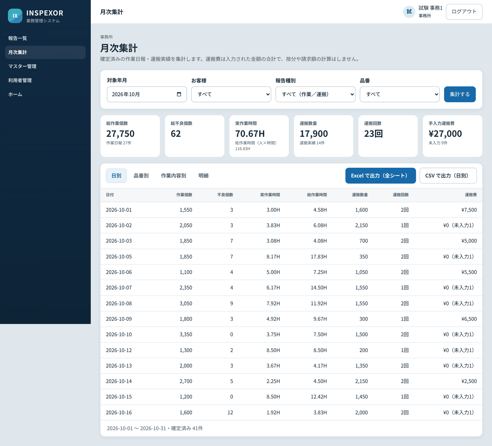<figcaption>図 5-13 月次集計（0.91 版の画面。合計の項目と表のタブを追加します）</figcaption></figure>

| 項目 | 種類 | 内容・規則 |
|---|---|---|
| 対象年月 | 年月 | 初期値は今月 |
| お客様・報告種別・品番 | 選択 | 絞り込みの条件（すべて、または1つ） |
| 集計する | ボタン | 確定済みの報告（修正中のものは前の確定版）を集計します |
| 合計 | 表示 | 総作業個数（作業日報の件数）、総不良個数、総作業時間、検査時間・検査外時間、時間外時間（請求する／しない）、割増作業時間・通常作業時間、運搬数量（運搬実績の件数）、運搬回数、手入力運搬費（未入力の件数） |
| 表 | タブ | 日別・品番別・作業内容別・作業者別・品番日別・明細 |
| 作業者別（追加） | 表 | 作業者×区分（検査／検査外、工程）ごとの作業日数と時間。ISO の記録としてお使いいただけます |
| 品番日別（追加） | 表 | 品番ごとに月の全日の行。有無・数量（仕上げ・検査）・不良数・通常作業時間・割増作業時間・作業時間・移動回数・入力者。事務所でお使いの品番ごとの集計表と同じ並びです。品番で絞ると、ビナン様の社内用日報の代わりの期間の一覧になります |
| Excel で出力（全シート） | ボタン | 集計・日別・品番別・作業内容別・作業者別・品番日別・明細の7シートを1つの Excel ファイルで保存 |
| CSV で出力 | ボタン | 表示中の表を CSV で保存（Excel で開いても文字化けしない形式） |

運搬費は入力された金額の合計です。按分や請求額の計算はしません。1件に複数の品番がある作業日報の時間は、品番別・品番日別の表では数量の比で分けた参考値です。

## 5.8 マスタ管理（SCR-16・17）

<figure>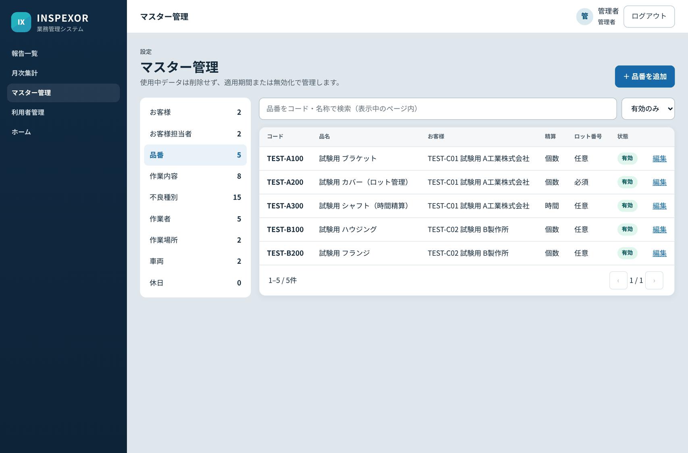<figcaption>図 5-14 マスタ一覧（品番）</figcaption></figure>
<figure>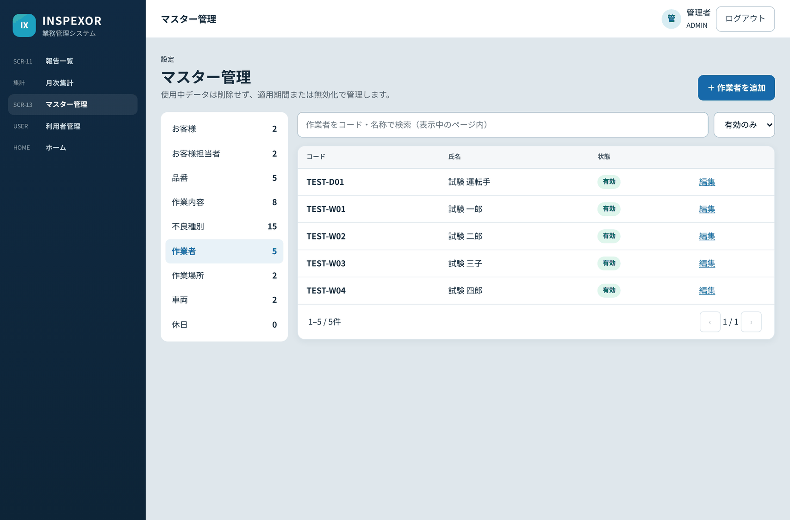<figcaption>図 5-15 マスタ一覧（作業者）</figcaption></figure>

<figure>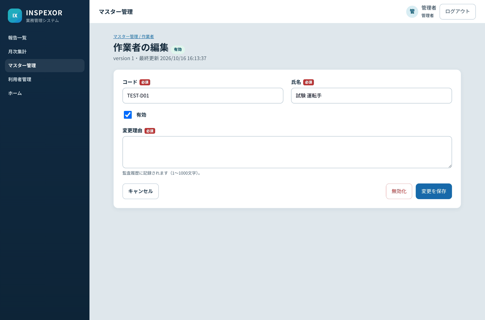<figcaption>図 5-16 マスタの編集</figcaption></figure>
<figure>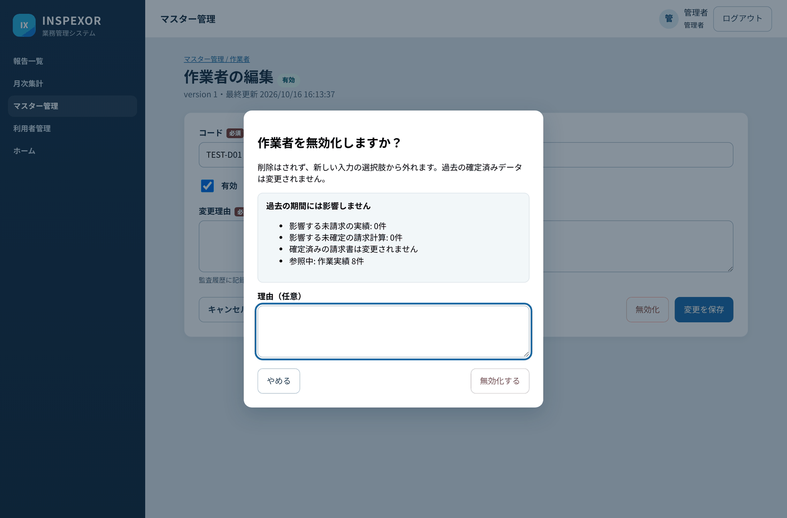<figcaption>図 5-17 無効にするときの確認</figcaption></figure>

| 表示・操作 | 内容・規則 |
|---|---|
| マスタの種類 | お客様・お客様担当者・品番・作業内容・不良種別・作業者・作業場所・車両・休日（左の一覧で切り替え、件数を表示） |
| 追加した項目（1.0 で変更） | 品番: 工程（なし／仕上げ・検査）、工程ごとに数量を入れる。作業内容: 既定の区分（検査／検査外）、既定の作業場所。作業場所: お客様の工場。お客様担当者: 部署名。（在庫の設定は在庫管理をお使いになる場合だけ表示） |
| 一覧 | コード・名称などの主な項目と有効／無効。検索と、有効・無効の絞り込みができます |
| 追加 | 管理者だけに表示します。コード・名称など、種類ごとの項目を入力します。同じコードは登録できません |
| 編集 | 変更理由（必須）を入力して保存します。変更は記録に残ります |
| 無効にする | 理由を入力して無効にします。無効にした項目は新しい入力の選択肢から外れ、過去の報告にはそのまま残ります。再び有効にもできます |
| 事務所の方 | 一覧の参照だけができます（追加・編集のボタンは表示しません） |

## 5.9 利用者管理（SCR-18）

<figure>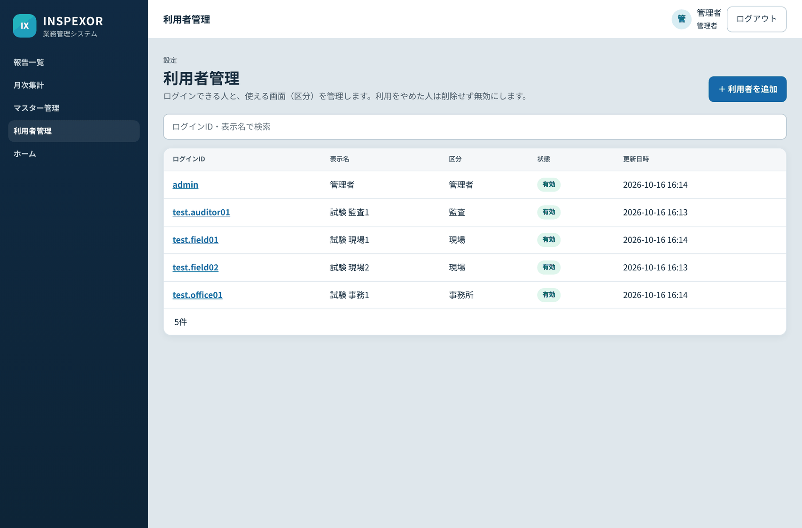<figcaption>図 5-18 利用者の一覧</figcaption></figure>
<figure>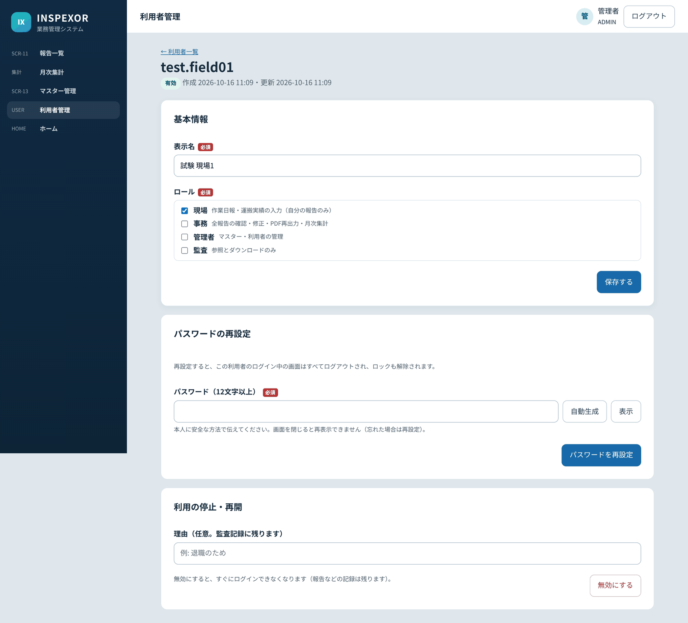<figcaption>図 5-19 利用者の詳細</figcaption></figure>

| 項目・操作 | 内容・規則 |
|---|---|
| 一覧 | ログインID・表示名・区分・状態・更新日時 |
| 利用者を追加 | ログインID（3〜100文字の英数字と . _ @ -、後から変更不可）、表示名（100文字まで）、区分（複数可）、パスワード（12〜128文字、自動生成も可） |
| 基本情報 | 表示名・区分の変更。区分を変えると、その方は次の操作で再ログインが必要になります |
| パスワードの再設定 | 新しいパスワードを設定します。ロックも解除されます。操作の前にご自身のパスワードの再入力（本人確認）を求めます |
| 利用の停止・再開 | 理由（任意。記録に残ります）を入力して停止します。停止した方はすぐにログインできなくなります。過去の報告は残ります |
| 保護 | 自分自身の停止、有効な管理者が0人になる変更はできません |

## 5.10 在庫（SCR-19、丸五ゴム様。ご相談中・範囲外）

提案書の範囲外の機能のため、進め方をご判断いただいてから作ります。画面の内容は次のとおりです（詳細は要件定義書 4.11）。

| 表示・操作 | 内容 |
|---|---|
| 在庫の一覧 | 品番（MN139931・MFI・FPR）ごとの預かり在庫（まだ納入していない検品分を検品日ごとに表示）と調整用在庫。目安を下回っていれば「1箱回してください」 |
| 日ごとの動き | 検品・1箱回す・納入・棚卸ごとの数と、調整用在庫の当日残（現行の集計表と同じ並び） |
| 納入を登録 | 検品のない日の納入（例: 8/20 に 8/19 の検品分を納入）。数はまだ納入していない分が自動で入ります |
| 調整用に1箱回す | 預かり在庫から1箱（入数）を調整用在庫へ |
| 棚卸 | 数えた数を入れ、差を理由付きで記録 |
| 利用開始時の残高 | 利用を始める日の在庫数 |
| 在庫集計表を出力 | 月・品番ごとの Excel（現行の「集計表（現場用）」と同じ欄、翌月最初の納入日の行を含む） |

作業日報（STEP4）では、在庫を管理する品番に「箱数」（自動で提案）、「この検品分から調整用に1箱回す」、「本日の納入数」（前日までの検品分が自動で入る）を表示します。

# 6. 帳票の見本

## 6.1 作業結果報告書（日報PDF）（1.0 で変更）

<figure class="pdf">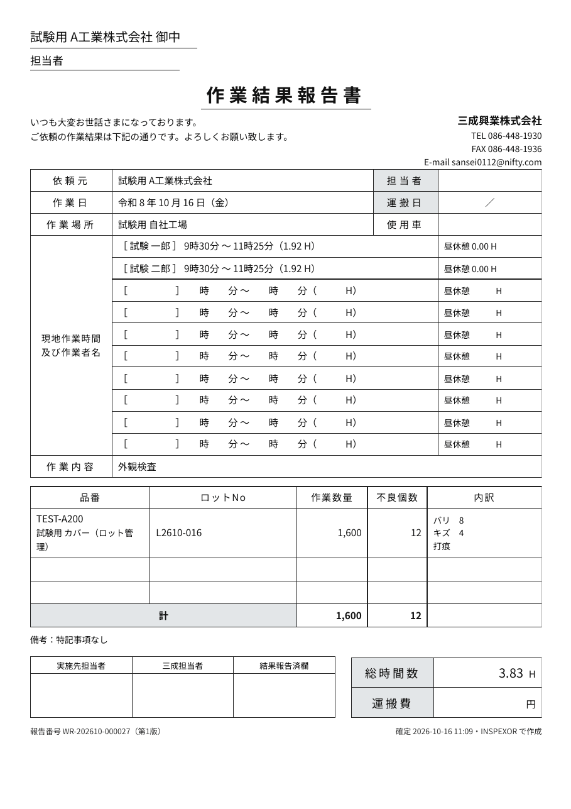<figcaption>図 6-1 作業結果報告書（0.91 版の様式。1.0 版で次の表のとおり変えます）</figcaption></figure>

現行の紙の作業結果報告書と同じ並びの A4 縦です。ファイル名は「日報_作業日_お客様コード_報告番号_r版.pdf」です。

| 欄 | 1.0 版の様式 |
|---|---|
| 宛名 | 「お客様名 御中」の下に部署名・担当者名（複数なら並べる） |
| 現地作業時間及び作業者名 | 1行に1人・1区分。「〔試験 一郎〕【検査】 8時30分〜17時00分（7.50H） 休憩 1.00H」。10行を超えると2枚目に続く |
| 作業内容 | 品番の行の作業内容（重複なし） |
| 品番・ロットNo・作業数量・不良個数・内訳 | 品番・ロットの行ごと（最低4行）。仕上げ・検査の品番は「仕上げ 454／検査 0」。内訳に「その他 2（色ハゲ）」 |
| 総時間数 | 全従事行の合計 |
| 運搬回数・運搬費 | 作業場所がお客様の工場なら「移動回数」「移動費」の欄にし、移動回数を印字（金額は空欄） |

改修の前に作成した PDF は、再出力しても作成したときの様式です。

## 6.2 運搬実績報告書（PDF）

<figure class="pdf">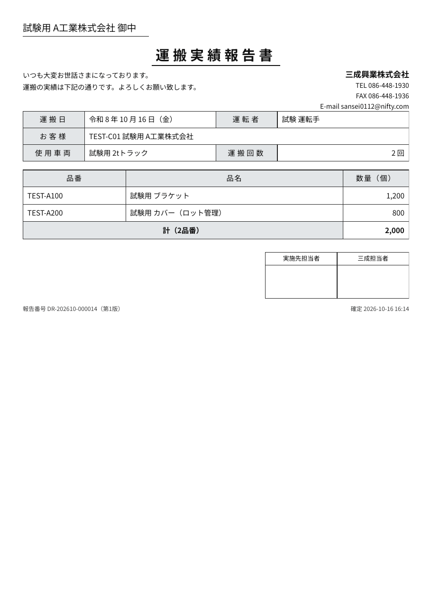<figcaption>図 6-2 運搬実績報告書（図 4-7 の運搬実績から作成）</figcaption></figure>

作業結果報告書と同じ体裁の A4 縦1枚です。使用車両・運搬回数を載せ、運搬費は載せません。ファイル名は「運搬_運搬日_お客様コード_報告番号_r版.pdf」です。

## 6.3 月次集計の Excel・CSV

| 出力 | 内容 |
|---|---|
| Excel（.xlsx） | 7シート: 集計（対象年月・条件と合計）、日別、品番別、作業内容別、作業者別、品番日別、明細（報告1件ごと） |
| CSV | 表ごとに1ファイル（UTF-8、Excel で開いても文字化けしない形式） |

# 7. 主なメッセージ

| 場面 | メッセージ |
|---|---|
| ログインの誤り | ログインIDまたはパスワードが正しくありません。 |
| ログインのロック | アカウントがロックされています。しばらく時間をおいてから再度お試しください。 |
| 入力の誤り（まとめ） | 入力内容を確認してください |
| 必須の選択 | 運転者を選択または入力してください。／お客様を選択または入力してください。 |
| 品番の未選択（運搬） | 品番を1件以上選択してください。 |
| 運搬費の範囲 | 運搬費は0〜9,999,999円の整数で入力するか、空欄にしてください。 |
| 作業者の未選択 | 作業者を1名以上追加してください。 |
| 作業者の時間の重なり | 同じ作業者の時間が重なっています。 |
| 終わっていない作業者 | 終了時刻が入っていない作業者がいます。全員の終了を入れてから進んでください。 |
| 休憩の範囲 | 休憩は作業時間より短くしてください。 |
| 時間外の範囲 | 時間外は実作業時間以下にしてください。 |
| 昼の休憩の目安 | 昼の休憩が0分です。必要なら休憩を入れてください。 |
| まとめられない品番 | この品番は同じ報告にまとめられません（精算区分または工程の設定が違います）。 |
| 同じロットの重複 | 同じ品番・同じロット番号の行があります。 |
| 破棄の理由 | 破棄の理由を入力してください。 |
| 不良の合計 | 不良数の合計が数量を超えています。 |
| 確認チェック | 「内容を確認しました」にチェックしてください。 |
| 登録完了 | 作業日報を登録しました／運搬実績を登録しました |
| 修正理由 | 修正理由を入力してください。 |
| 再出力の理由 | 再出力の理由を入力してください。／再出力を受け付けました |
| 代理入力の理由 | 代理入力の理由を入力してください。 |
| 通信切れ | オフラインです。入力は端末に下書き保存されます。確定は通信が戻るまでできません。 |
| 権限 | この画面を表示する権限がありません |

# 8. ご確認いただきたい事項

## 8.1 画面についてのご確認

| No | ご確認いただきたいこと | 当方の案 |
|---|---|---|
| U-01 | 作業日報の入力の段階（5つ）と項目の並び。作業中の日報への追記の流れ（4.3・4.5）が現場の作業に合っているか | 本書 4.5 のとおり |
| U-02 | 項目名・ボタン名の言葉づかい（例: 処理数量／作業数量、使用車／使用車両、休憩／昼休憩） | 帳票（作業結果報告書）の言葉に合わせて統一することもできます |
| U-03 | 代理入力（5.6）の要否（要件定義書 F-16・Q-07） | 事務所の方だけが、理由を入力して使える形で残す |
| U-04 | iPad の機種と画面の向き（本書は縦向きで確認） | 縦向き |
| U-05 | 事務所のパソコンの画面の大きさ（幅 1280 以上で報告一覧の全列が表示されます） | — |
| U-06 | 要件定義書 7章の確認事項 Q-02〜Q-12 | 要件定義書のとおり |
| U-07 | 報告詳細の「時間外を請求する」を事務所が報告ごとに指定する形（5.3） | 本書 5.3 のとおり |
| U-08 | 作業中の日報を、どの現場の方の iPad からも追記できるようにしてよいか（4.3） | 追記できるようにする（作業日・品番の変更と確定は報告者と事務所だけ） |
| U-09 | STEP3 の目安（昼の休憩・時間外）の表示（4.5） | 表示し、「目安を入れる」で入れる（自動では入れない） |

## 8.2 0.9 版から直した点

| No | 0.9 版での状態 | 対応（0.91 版） |
|---|---|---|
| K-01 | 報告一覧の表が、画面の幅 1366 のパソコンでは右にはみ出し、運搬費・状態・帳票の列が横に動かさないと見えなかった | お客様・品番の長い名称を折り返し、余白を詰めて、幅 1280 以上で全列を表示（図 5-5） |
| K-02 | 事務所の左メニューに開発用の記号（SCR-11・SCR-13・集計・USER・HOME）が表示されていた | 記号を表示しない。画面の幅が狭いときだけ短い名称（一覧・集計・マスタ・利用者・ホーム）を表示 |
| K-03 | 区分が英語の記号（FIELD・OFFICE・ADMIN）で表示され、利用者管理では「ロール」と表示していた | 「現場」「事務所」「管理者」「監査」で表示し、「区分」に統一 |

## 8.3 1.0 版で変えた点（10月の業務ヒアリングのご要望）

| No | ご要望・ご回答 | 1.0 版の画面 |
|---|---|---|
| H-01 | 作業者ごとに開始・終了時刻が違う。途中から加わる人・先に帰る人がいる | STEP3 を作業者ごとの行に。「作業者を追加」「開始」「終了」。現場ホームに作業中の日報 |
| H-02 | 作業者ごとに検査・検査外を記録（ISO の要件。請求単価には使わない） | STEP3 の行ごとの区分。月次集計の作業者別 |
| H-03 | ビナン様の仕上げと検査は単価が違う | 仕上げ・検査の工程がある品番は行の区分を仕上げ・検査に。請求書で分けている品番は STEP4 で仕上げ数量・検査数量 |
| H-04 | 休憩と時間外は手入力に。時間外を請求しない場合がある | STEP3 の休憩・時間外は手入力（目安の表示だけ）。報告詳細で時間外を請求するかを指定 |
| H-05 | 1枚の報告書に複数の品番・ロットがある（品番一覧・集計表・請求書で確認） | STEP2・STEP4 を品番・ロットの行に |
| H-06 | お客様の工場では移動回数・移動費の欄 | 作業場所がお客様の工場なら移動回数を入力し、帳票の欄を切り替え |
| H-07 | 丸五ゴム様の在庫管理（ご相談） | 在庫の画面（5.10）。ご判断後に作ります |

